 

 

**[▶ Empezar con la guía de 15 minutos](https://github.com/jorgefsb/linkedin-automation-template/blob/main/docs/SETUP.md)** · Más proyectos en [github.com/jorgefsb](https://github.com/jorgefsb)

---

Diagrama del flujo. No es una captura: esta plantilla son carpetas, plantillas y prompts, no una app.

## ¿Qué es?

Una plantilla abierta para convertir una infografía o imagen en cuatro borradores de post para LinkedIn, sin perder el crédito a la fuente ni tu voz.

## ¿Para quién es?

Para profesionales y equipos chicos que publican en LinkedIn, ya usan una IA como Claude o ChatGPT y tienen material visual guardado sin aprovechar.

## ¿Qué dolor resuelve?

Publicar seguido quita tiempo. Y cuando se le encarga a una IA sin sistema, sale contenido genérico, con la misma voz que todos y sin crédito a quien hizo la fuente.

## La propuesta

Un sistema de carpetas, plantillas y prompts. Entra una fuente visual y salen cuatro borradores en formatos distintos, cada uno con sus créditos. La IA acelera el primer borrador; tú pones criterio, experiencia, edición y la conversación con tu comunidad.

| Formato | Plantilla |
|---|---|
| Educativo | [`educational.md`](./02-templates/post-templates/educational.md) |
| Con datos | [`data-driven.md`](./02-templates/post-templates/data-driven.md) |
| Opinión | [`hot-take.md`](./02-templates/post-templates/hot-take.md) |
| Caso | [`case-study.md`](./02-templates/post-templates/case-study.md) |

## ¿Cómo se usa?

1. Clona el repo o usa «Use this template».
2. Pon tus infografías en `01-infographics/` y llena sus créditos con el ejemplo `credits-EXAMPLE.json`.
3. Describe tu voz en `02-templates/brand-adapters/`.
4. Corre el prompt de `06-prompts/batch-generator.md` en tu IA.
5. Edita los borradores y publica tú.

La guía paso a paso está en [docs/SETUP.md](./docs/SETUP.md), en inglés.

## ¿Cuándo conviene y cuándo no?

Conviene si ya tienes infografías, gráficas o láminas y quieres sacarles más provecho con un método repetible.

No publica por ti ni se conecta a LinkedIn: genera borradores que tú revisas. Tampoco promete resultados; este repo no trae métricas verificadas.

## ¿Dónde lo pruebo?

Aquí mismo: **[docs/SETUP.md](./docs/SETUP.md)**. No hay nada que instalar.

## Hasta dónde llegamos

Plantilla 1.0 con cuatro formatos de post, un adaptador de voz, un generador por lotes, un traductor y un sistema de créditos. Última actualización del contenido: 22 de agosto de 2026.

Pendiente: traducir la guía completa al español.

## Para quien construye

No hay código que correr: son archivos Markdown y un JSON de ejemplo. La [guía completa](./docs/GUIDE.md) (en inglés) explica la estructura, la estrategia de publicación y cómo adaptarla a tu nicho. También hay [FAQ](./docs/FAQ.md), [flujos](./docs/WORKFLOWS.md) y [personalización](./docs/CUSTOMIZATION.md).

## Licencia

[MIT](./LICENSE). Úsala, cámbiala y compártela.

---

Hecho con amor ❤️🎮 por <a href="https://jorgesuarez.com.mx">JorgeSuarez.com.mx</a> · <a href="https://github.com/jorgefsb">Más proyectos</a> · <a href="./README.md">Read in English</a> Documentación actualizada el 10 nov 2026.

