 

 

**[▶ Start with the 15-minute guide](./docs/SETUP.md)** · More projects at [github.com/jorgefsb](https://github.com/jorgefsb)

---

Flow diagram. This is not a screenshot: the template is folders, templates and prompts, not an app.

## What is it?

An open template that turns one infographic or image into four LinkedIn post drafts without losing credit to the source or your own voice.

## Who is it for?

For professionals and small teams who post on LinkedIn, already use an AI like Claude or ChatGPT and have visual material sitting unused.

## What pain does it solve?

Posting often takes time. And when you hand it to an AI with no system, you get generic content in the same voice as everyone else and with no credit to whoever made the source.

## The proposal

A system of folders, templates and prompts. One visual source goes in and four drafts in different formats come out, each with its credits. The AI speeds up the first draft; you bring judgment, experience, editing and the conversation with your community.

| Format | Template |
|---|---|
| Educational | [`educational.md`](./02-templates/post-templates/educational.md) |
| Data-driven | [`data-driven.md`](./02-templates/post-templates/data-driven.md) |
| Hot take | [`hot-take.md`](./02-templates/post-templates/hot-take.md) |
| Case study | [`case-study.md`](./02-templates/post-templates/case-study.md) |

## How do I use it?

1. Clone the repo or click "Use this template".
2. Put your infographics in `01-infographics/` and fill in their credits using `credits-EXAMPLE.json`.
3. Describe your voice in `02-templates/brand-adapters/`.
4. Run the prompt in `06-prompts/batch-generator.md` in your AI.
5. Edit the drafts and publish them yourself.

The step-by-step guide is in [docs/SETUP.md](./docs/SETUP.md).

## When it fits and when it doesn't

It fits if you already have infographics, charts or slides and want to get more out of them with a repeatable method.

It does not post for you or connect to LinkedIn: it produces drafts that you review. It does not promise results either; this repo ships no verified metrics.

## Where can I try it?

Right here: **[docs/SETUP.md](./docs/SETUP.md)**. There is nothing to install.

## How far we got

Template 1.0 with four post formats, a voice adapter, a batch generator, a translator and a credits system. Content last updated on 22 August 2026.

Pending: a full Spanish translation of the guide.

## For builders

There is no code to run: it is Markdown files and one example JSON. The [full guide](./docs/GUIDE.md) explains the structure, the publishing strategy and how to adapt it to your niche. There is also an [FAQ](./docs/FAQ.md), [workflows](./docs/WORKFLOWS.md) and [customization](./docs/CUSTOMIZATION.md).

## License

[MIT](./LICENSE). Use it, change it and share it.

---

Made with love ❤️🎮 by <a href="https://jorgesuarez.com.mx">JorgeSuarez.com.mx</a> · <a href="https://github.com/jorgefsb">More projects</a> · <a href="./README.es.md">Leer en español</a> Documentation updated on 10 Nov 2026.

